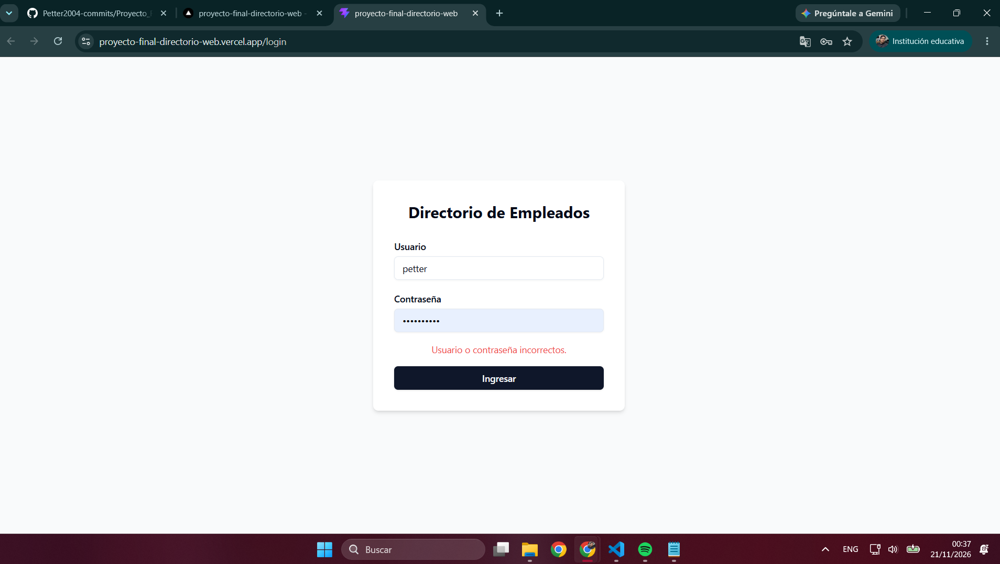
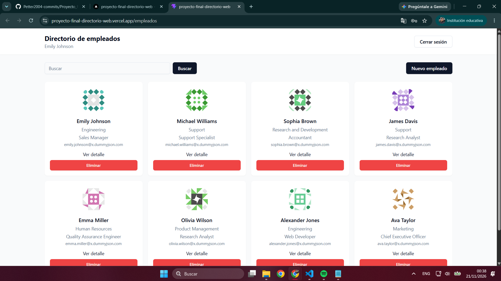
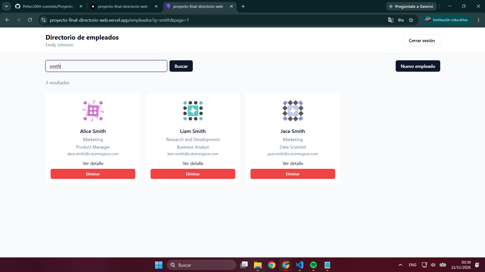
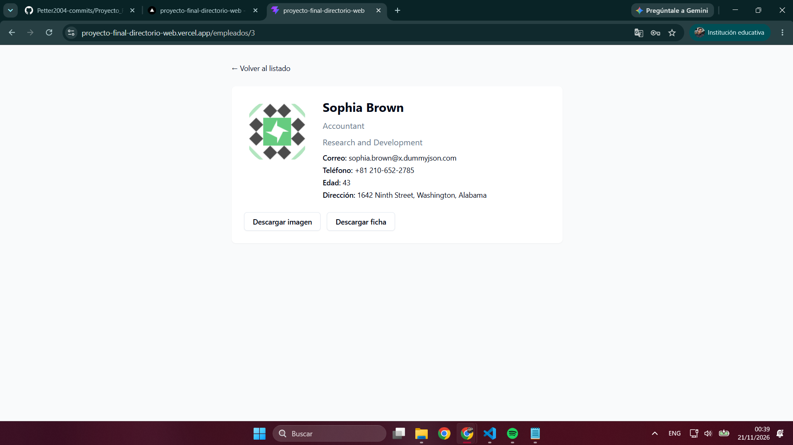
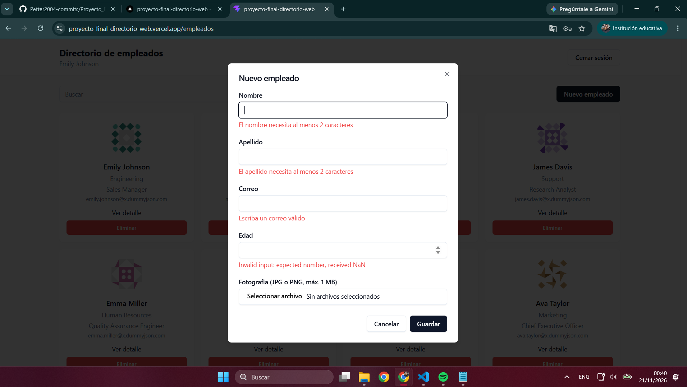
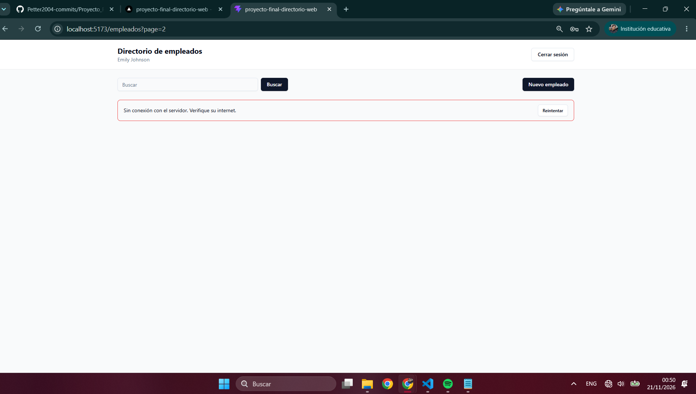

# Directorio de Empleados

Proyecto de recuperación — Curso 036 Desarrollo Web  
Universidad Mariano Gálvez de Guatemala  
Estudiante: Petter Deiman Alvarez Garcia

Aplicación web para gestionar el directorio de empleados de una empresa. Permite iniciar sesión, ver el listado paginado, buscar por nombre, ver el detalle de cada empleado, descargar su fotografía y ficha, agregar nuevos empleados y darlos de baja. Los datos provienen de la API pública DummyJSON.

## Tecnologías

- React 19 + TypeScript
- Vite
- Tailwind CSS
- shadcn/ui (Radix UI)
- React Router DOM
- Zustand (persistencia de sesión)
- TanStack Query
- Axios
- React Hook Form + Zod
- React Hot Toast

## Instalación y ejecución

```bash
npm install
npm run dev
```

## Variables de entorno

Copia `.env.example` a `.env` y ajusta si es necesario:

```
VITE_API_URL=https://dummyjson.com
```

## Sitio desplegado

https://proyecto-final-directorio-web.vercel.app

## Capturas de pantalla

### Inicio de sesión con credenciales incorrectas


### Directorio con paginación


### Búsqueda con resultados


### Detalle de empleado


### Formulario con error de validación


### Tarjeta de error con Reintentar
